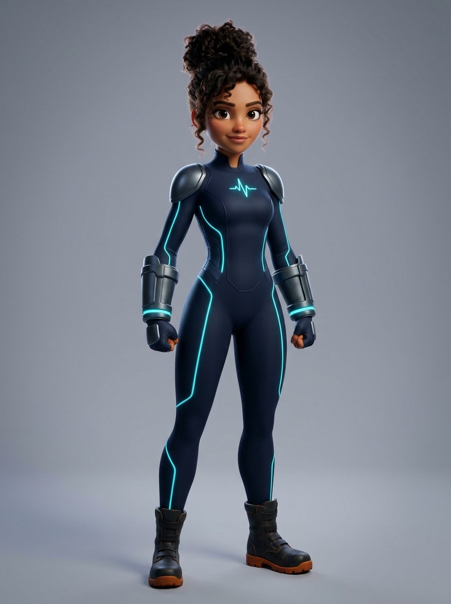
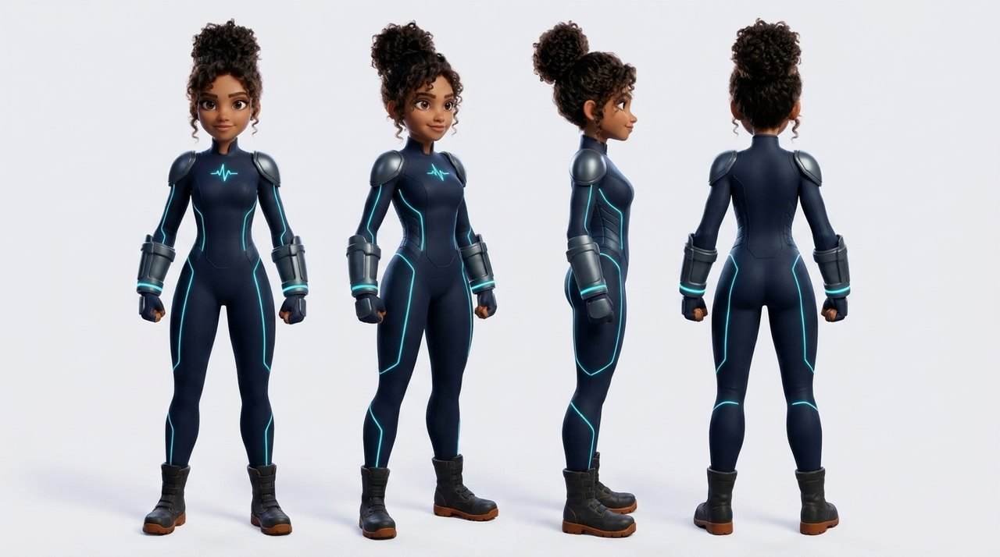
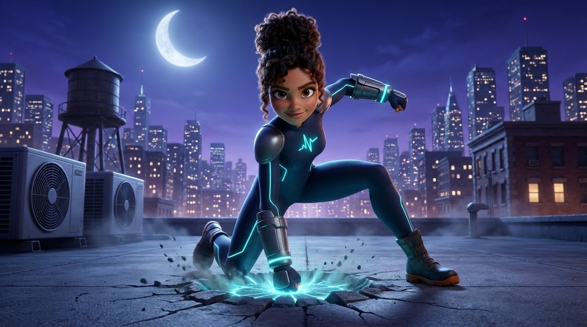
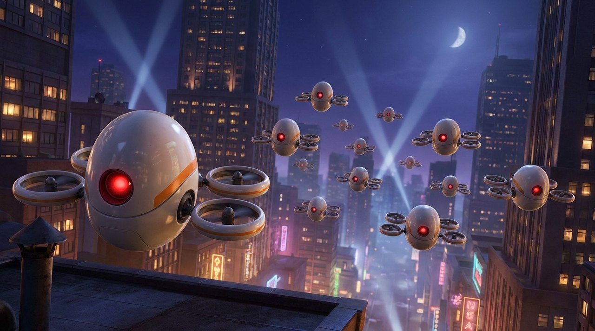
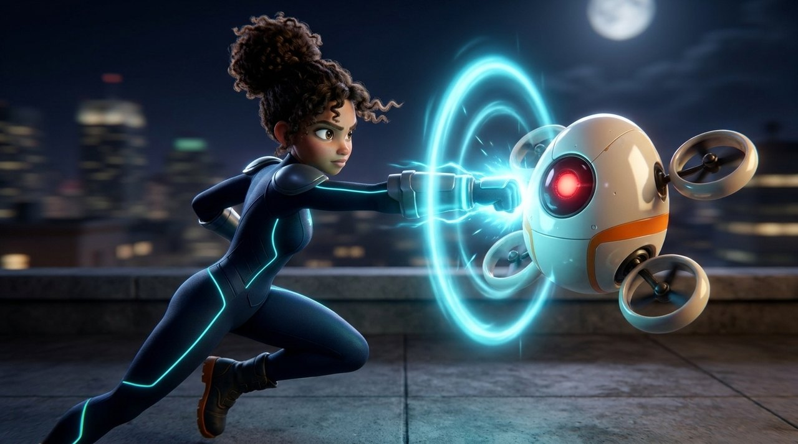
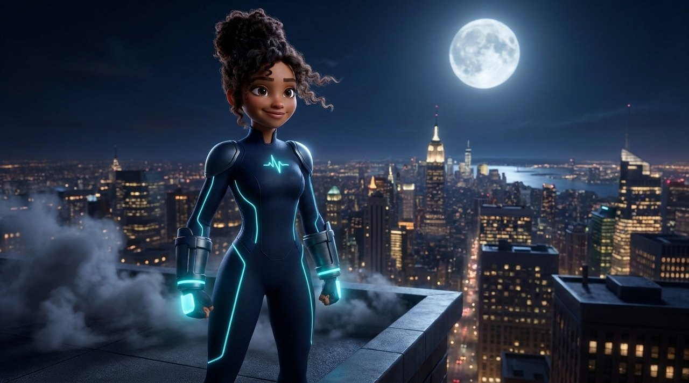
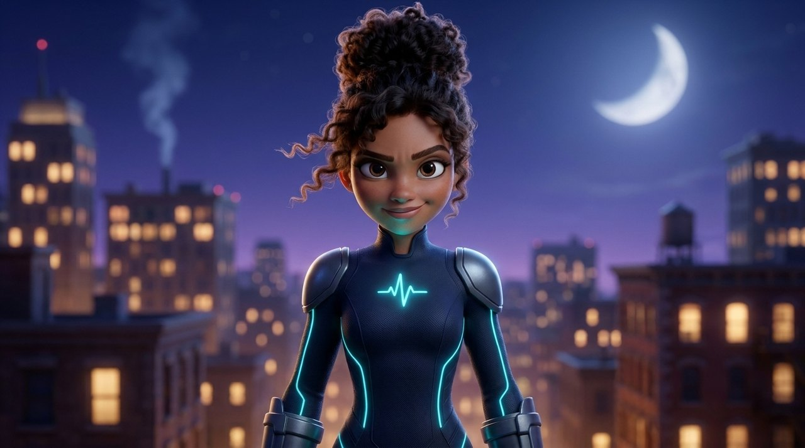

# The Skypulse Prompt Pack

Every prompt from the video **"How I Make Pixar-Style Action Scenes With Claude + Veo 3.1"**, copied from the real production calls. Nothing here was rewritten after the fact; line breaks were added between beats so the prompts are easier to read.

**Tools:** Claude Code (writes the prompts, checks every frame) · Google Flow on the AI Pro plan (Nano Banana Pro images, Veo 3.1 Fast video) · [Flow MCP](https://github.com/GTAI-1/flow-mcp) (free, open source, lets Claude drive Flow) · ElevenLabs (narrator, Voice Changer, music, sound effects).

**Contents**

1. The character prompt
2. The turnaround sheet
3. The identity bracket
4. Keyframe prompts (0 credits)
5. The 8-second beat formula
6. The final video prompts
7. The 3 takes that broke and the lock sentences that fixed them
8. The dialogue shot and the voice swap
9. The cost sheet

---

## 1. The character prompt

Model: Nano Banana Pro · cost: 0 credits

The face rule: **show the face** (no mask, no helmet), then spell out every piece of the costume: colour, material, exactly where it glows.

```text
Original superhero in a high-end Pixar-style 3D animated feature film look. A young woman in her mid-20s, warm light-brown skin, big expressive dark-brown eyes, friendly confident face with a small determined smile, thick dark curly hair tied in a high messy bun with loose curls blowing around her face, no mask, face fully visible. Athletic heroic build. Sleek form-fitting midnight-navy suit with soft matte fabric texture, thin glowing electric-cyan energy seams running along the arms, legs and ribs, a small cyan pulse-wave emblem (a single heartbeat line) across the chest, smooth dark-grey shoulder guards, chunky gauntlets on both forearms with glowing cyan rings, sturdy dark boots with orange soles. No cape.
```



## 2. The turnaround sheet

Model: Nano Banana Pro · reference image: the hero portrait from step 1 · cost: 0 credits

```text
Professional character turnaround model sheet of the superhero woman from the reference image (same face, same curly high bun, same midnight-navy suit with glowing cyan seams, cyan heartbeat chest emblem, grey shoulder guards, forearm gauntlets with cyan rings, dark boots with orange soles): four full-body views side by side on a clean light-grey background - front view, three-quarter view, side view and back view - same neutral standing pose, same scale, evenly spaced. Pixar-style 3D animated feature character design sheet, soft studio lighting, crisp detail. No text, no labels.
```



## 3. The identity bracket

Paste this into **every** image prompt that shows the hero, with the portrait file attached as the reference image.

```text
The superhero woman from the reference image (same face, same curly high bun, same midnight-navy suit with glowing cyan seams, cyan heartbeat chest emblem, grey shoulder guards, forearm gauntlets with cyan rings, dark boots with orange soles)
```

Tip: in Flow MCP, attach the portrait as a **file path** in `reference_images`. Referencing the saved character as `asset:<name>` made the download step fail in this production.

## 4. Keyframe prompts (0 credits)

Never start with video. Claude writes the first frame of every shot, Nano Banana Pro renders it, Claude checks it, and a bad frame is simply redone for free.

### Shot 1: the landing

```text
The superhero woman from the reference image (same face, same curly high bun, same midnight-navy suit with glowing cyan seams, cyan heartbeat chest emblem, grey shoulder guards, forearm gauntlets with cyan rings, dark boots with orange soles) has just landed on a city rooftop at night in a three-point superhero landing: right knee and right fist on the concrete, left foot planted forward, left arm swept back, head raised, determined smile. The concrete under her fist is cracked in a small radial crater with a ring of cyan light and dust rolling outward. Low-angle camera at ground level 3 m in front of her, 28mm. Behind her: rooftop AC units, a water tower and a glowing night skyline under a deep blue-violet sky with a big moon. High-end Pixar-style 3D animated feature film frame, cinematic rim light, volumetric haze.
```



### Shot 2: the drone swarm (no hero, no reference)

```text
A swarm of about fifteen small sentry robot drones flies over a glowing night city toward the camera between skyscrapers. Every drone is identical: a glossy off-white rounded egg-shaped shell, one glowing red eye, an orange stripe around the middle and four small ducted rotors. The nearest drone is large in the foreground, the others recede into the haze. Wide shot from a rooftop looking out over the skyline, deep blue-violet night sky, moon, warm lit windows, searchlight beams. High-end Pixar-style 3D animated feature film frame, cinematic lighting, atmospheric depth, rich colour grading. No people.
```



### Shot 3: the punch

```text
The superhero woman from the reference image (same face, same curly high bun, same midnight-navy suit with glowing cyan seams, forearm gauntlets with cyan rings) lunges forward on a night rooftop and lands a punch on a small hovering sentry drone (glossy off-white egg-shaped shell, one glowing red eye, orange stripe, four small ducted rotors). Her right fist glows cyan at the moment of impact and a bright cyan shockwave ring spreads from the contact point. Focused face, curls flying, dynamic lunge. Side camera at chest height, 35mm, background slightly motion-blurred. Night skyline and moon behind. High-end Pixar-style 3D animated feature film action frame, dramatic rim light.
```



### Shot 4: the hero pose

```text
The superhero woman from the reference image (same face, same curly high bun, same midnight-navy suit with glowing cyan seams, cyan heartbeat chest emblem, forearm gauntlets with cyan rings, boots with orange soles) stands at the edge of a rooftop at night after the fight, fists softly glowing cyan, wind blowing her curls, confident warm smile, looking out over the city. Low-angle hero shot from slightly below, 4 m away, 35mm, the glowing skyline and a big moon behind her, a wisp of smoke drifting. High-end Pixar-style 3D animated feature film frame, heroic composition, cinematic rim light.
```



### Shot 5: the dialogue close-up

```text
The superhero woman from the reference image (same face, same curly high bun, same midnight-navy suit with glowing cyan seams, cyan heartbeat chest emblem, grey shoulder guards, forearm gauntlets with cyan rings) stands on a city rooftop at night and looks straight into the camera with a playful, confident half-smile, mouth closed, one eyebrow slightly raised. Medium close-up from the chest up, camera at her eye level about 1.5 m away, 50mm lens, she is centred in frame. Behind her, softly out of focus: the glowing night skyline with warm lit windows, a deep blue-violet sky, a big moon and a thin wisp of smoke. The wind lifts a few loose curls. High-end Pixar-style 3D animated feature film frame, cinematic rim light, a soft cyan glow from her suit on her chin, gentle volumetric haze.
```



## 5. The 8-second beat formula

Every keyframe becomes the **first frame** of an 8-second Veo 3.1 Fast clip (20 credits, with a hard cap on every shot).

```text
0-2 s: [one action]
2-6 s: [one action]
6-8 s: [one action]
[lock sentences: whatever must not change]
Camera: [one camera move], one continuous shot. Same [set pieces] as the first frame. High-end Pixar-style 3D animated feature film look, cinematic rim light.
Sound: [what you want to hear]. No music, no dialogue.
```

Rules: one action per beat, one camera move, then the sound. No music in the clip; music comes later in the edit.

## 6. The final video prompts

Model: Veo 3.1 Fast · first frame: the keyframe from section 4 · 20 credits each · safety cap: `max_credits: 25`, one output per prompt.

### Shot 1: the landing (take 2, the one in the video)

```text
0-2 s: the superhero woman stays perfectly still in her three-point landing on the cracked rooftop while the dust drifts away and the cyan glow in the cracks dims.
2-6 s: in one smooth, controlled motion she rises from the landing and stands up straight, feet apart, arms relaxed at her sides.
6-8 s: she lifts her chin and looks up at the moon with a confident smile.
Her hair stays in the same high curly bun the whole time. The crater under her stays where it is. No new glowing effects appear.
Camera: static at ground level, locked off, one continuous shot. Same rooftop, water tower, AC units, skyline and moon as the first frame. High-end Pixar-style 3D animated feature film look, cinematic rim light.
Sound: deep impact rumble fading out, night wind, distant city traffic. No music, no dialogue.
```

### Shot 2: the drone swarm (take 1 worked)

```text
The swarm of identical off-white egg-shaped sentry drones with glowing red eyes flies steadily forward toward the camera between the skyscrapers, rotors spinning, the nearest drone drifting closer and its red eye brightening. Searchlight beams sweep slowly across the violet night sky.
Camera: static on the rooftop with a very slow push-in, one continuous shot. Same city, drones and moon as the first frame. High-end Pixar-style 3D animated feature film look, atmospheric haze.
Sound: a rising chorus of buzzing rotors, a low ominous electronic hum, distant sirens. No music, no dialogue.
```

### Shot 3: the punch (take 2)

```text
0-1.5 s: the superhero woman's glowing fist connects with the drone and the cyan shockwave ring flashes once.
1.5-3 s: the whole drone, still in one piece, is knocked straight back and flies out of frame to the right.
3-8 s: she holds her punching pose for a moment, then slowly lowers her fist and settles into a calm, balanced stance, still seen from the side, with a small satisfied smile.
Her suit never changes: the same midnight-navy suit with thin cyan seams, the same small thin heartbeat-line emblem on her chest, the same grey forearm gauntlets with thin cyan rings.
Camera: static side view at chest height, locked off, one continuous shot. Same rooftop, skyline and moon as the first frame. High-end Pixar-style 3D animated feature film look, dramatic rim light.
Sound: one sharp electric energy blast, a metallic clang, the drone's rotors whining away into the distance, wind. No music, no dialogue.
```

### Shot 4: the hero pose (take 2)

```text
0-3 s: the superhero woman stands still at the rooftop edge, facing the camera at three-quarter view, wind gently blowing her curls, the cyan glow on her fists slowly fading.
3-6 s: she turns only her head toward the camera and breaks into a warm, confident smile.
6-8 s: she gives one small nod.
Her arms stay relaxed at her sides the whole time. Her suit never changes: the same midnight-navy suit with thin cyan seams, the same small heartbeat-line chest emblem, the same slim grey forearm gauntlets at the same size.
Camera: static, locked off at chest height with a very slow push-in, one continuous shot. Same rooftop, smoke, skyline and full moon as the first frame. High-end Pixar-style 3D animated feature film look, cinematic rim light.
Sound: night wind, distant city ambience, a soft electric hum fading out. No music, no dialogue.
```

## 7. The 3 takes that broke

Three of the four action shots failed on the first take. Each fix was a sentence that **locks** what broke.

| Shot | What broke on take 1 | Lock sentence added to take 2 |
|---|---|---|
| 1 · The landing | Her bun fell into loose hair; a glowing ring appeared out of nowhere | "Her hair stays in the same high curly bun the whole time." "No new glowing effects appear." |
| 3 · The punch | The drone shattered; her chest emblem turned into a glowing shield | "...the whole drone, still in one piece, is knocked straight back..." "Her suit never changes: ..." |
| 4 · The hero pose | The camera orbit swung behind her; her gauntlets doubled in size | "Camera: static, locked off..." "...the same slim grey forearm gauntlets at the same size." |

The rule: **whatever breaks, write a sentence that locks it.**

The take-1 prompts, for comparison:

**Shot 1, take 1** (bun fell, new glowing ring)

```text
0-2 s: the superhero woman holds her three-point landing on the cracked rooftop while the ring of cyan light under her fist fades and the dust settles.
2-6 s: she pushes up from the concrete and rises smoothly to stand tall, her curls swaying, the cyan seams on her suit pulsing once.
6-8 s: she lifts her chin and looks up at the night sky with a confident smile.
Camera: slow push-in at ground level, one continuous shot. Same rooftop, water tower, AC units, skyline and moon as the first frame. High-end Pixar-style 3D animated feature film look, cinematic rim light.
Sound: deep impact rumble fading out, night wind, distant city traffic, a soft electric hum from her suit. No music, no dialogue.
```

**Shot 3, take 1** (drone shattered, emblem became a shield)

```text
0-1.5 s: the superhero woman's glowing cyan fist connects and the cyan shockwave ring bursts outward.
1.5-4 s: the off-white drone is knocked backward and flies away to the right, spinning slowly, its red eye flickering off as it drops out of frame.
4-8 s: she finishes the punch, plants her back foot, lowers her fist and straightens up, breathing hard, curls settling, with a small satisfied smile.
Camera: static side view at chest height, one continuous shot. Same rooftop, skyline and moon as the first frame. High-end Pixar-style 3D animated feature film look, dramatic rim light.
Sound: a sharp electric energy blast, a metallic clang, the drone's rotors whining down as it falls away, wind. No music, no dialogue.
```

**Shot 4, take 1** (camera orbited behind her, gauntlets doubled)

```text
0-3 s: the superhero woman stands at the rooftop edge looking out over the city, wind blowing her curls, the cyan glow on her fists slowly fading.
3-6 s: she turns her head toward the camera with a warm, confident smile.
6-8 s: she gives one small nod.
Camera: slow arc around her from her right side toward the front at chest height, one continuous shot. Same rooftop, smoke, skyline and full moon as the first frame. High-end Pixar-style 3D animated feature film look, cinematic rim light.
Sound: night wind, distant city ambience, a soft electric hum fading out. No music, no dialogue.
```

## 8. The dialogue shot and the voice swap

Put the line **in quotes, inside the timeline, at the second she says it.** Veo moves the lips and records a voice.

Model: Veo 3.1 Fast · first frame: the dialogue close-up from section 4 · 20 credits

```text
0-0.7 s: the superhero woman looks straight into the camera with a playful half-smile, silent.
0.7-6.5 s: still looking straight into the lens, she says in a bright, warm, confident young woman's voice, clearly and at a quick natural pace: "I'm Skypulse. I'm not real. Claude directed every frame of me. Want the prompts?" She raises her eyebrows on the last words and tilts her head slightly.
6.5-8 s: she stops talking and holds a small knowing smile, still facing the camera.
Her hair stays in the same high curly bun the whole time. Her suit never changes: the same midnight-navy suit with thin cyan seams, the same small heartbeat-line emblem on her chest, the same grey shoulder guards. Her arms stay relaxed at her sides.
Camera: static, locked off at her eye level with a very slow push-in, one continuous shot. Same rooftop, skyline, smoke and crescent moon as the first frame. High-end Pixar-style 3D animated feature film look, cinematic rim light.
Sound: only her voice, clear and close, soft night wind, distant city hum. No music.
```

**The voice swap:**

1. Extract the audio of the Veo clip.
2. Run it through **ElevenLabs Voice Changer** (speech-to-speech) with the voice you want. This video used "Jessica".
3. Put the new audio back on the clip. Voice Changer keeps Veo's exact timing, so the lips still match.

Tip: if you call ElevenLabs through its API, the key needs the **Voice Changer** permission switched on.

## 9. The cost sheet

| Item | Takes | Credits |
|---|---|---|
| Shot 1 · landing | 2 | 40 |
| Shot 2 · swarm | 1 | 20 |
| Shot 3 · punch | 2 | 40 |
| Shot 4 · hero pose | 2 | 40 |
| Shot 5 · dialogue | 1 | 20 |
| 8 images (keyframes, sheets) | - | 0 |
| **Total** | **8 Veo 3.1 Fast takes** | **160 Google Flow credits** |

That's about 32 seconds of finished animation (5 credits per second). Perfect for a scene; at the same rate a 30-minute film would be about 9,000 credits, so keep it short.

Budget: **about 160 Flow credits for a 30-second scene.** Prices in Flow can change, so check the live quote before you render.

---

Skypulse is an original character made for this video. "Pixar-style" describes the look only; not affiliated with or endorsed by Pixar, Anthropic, Google or ElevenLabs.
