# Vox-Style Paper-Collage Explainer: Prompt Pack

The demo story: the fake "pterodactyl over Mexico" video that went viral in November 2026. Every picture in the explainer is an AI recreation in a paper-collage style; no real footage is used.

Every prompt from the video "How I Make Vox-Style Explainers With Claude + Veo 3.1", copied exactly as it was sent to Google Flow on 2026-11-19. They are not cleaned up after the fact. Failed takes are included next to the lock sentence that fixed each one.

Tools: Claude Code (writes prompts, checks frames, codes the motion graphics), Google Flow (Nano Banana Pro images at 0 credits; Veo 3.1 Fast at 20 credits per 8 s clip), Flow MCP (lets Claude drive Flow), ElevenLabs (narration + music).

---

## 1. The style lock

Paste this at the end of every prompt. The last sentence is the no-text rule: the picture never carries words, and Claude adds all text later in code.

**Images (keyframes):**
```
Editorial paper-collage explainer look: black-and-white halftone photo cutouts with torn white paper edges, cream textured paper, flat cut-paper shapes in mustard yellow, tomato red and teal, soft drop shadows between paper layers, stop-motion paper feel. No text, no letters, no numbers, no logos.
```

**Video (v2, after take 1 stuttered):** replace "stop-motion paper feel" with:
```
paper puppet-theatre feel with smooth, fluid motion at full frame rate, no text, no letters, no logos.
```
Note: Veo still animates paper cutouts "on twos" (12 poses a second). Keep the clips at 24 fps and never convert them to 30 fps, because that is where the judder comes from.

---

## 2. Keyframes first (Nano Banana Pro, 0 credits)

Make one keyframe per story beat and check every frame before you spend a credit.

1. **Night sky**
   A night sky over a desert city in northern Mexico, made as an editorial paper-collage explainer illustration. A dark pterodactyl silhouette cut from black cardstock, with long pointed wings, a long beak and a backward-pointing head crest, glides in the upper right of the frame, just about to cross in front of a big round cream-coloured paper moon. Along the bottom: a row of low flat-roofed houses, wooden power poles with sagging wires and a rooftop water tank, all cut from black-and-white halftone photographs with torn white paper edges, stacked in overlapping layers. Behind them, kraft-brown cut-paper desert hills. The sky is deep teal paper with visible fibres and a fine printed dot texture. Wide shot, straight-on, flat layered composition with lots of sky. [style lock]

   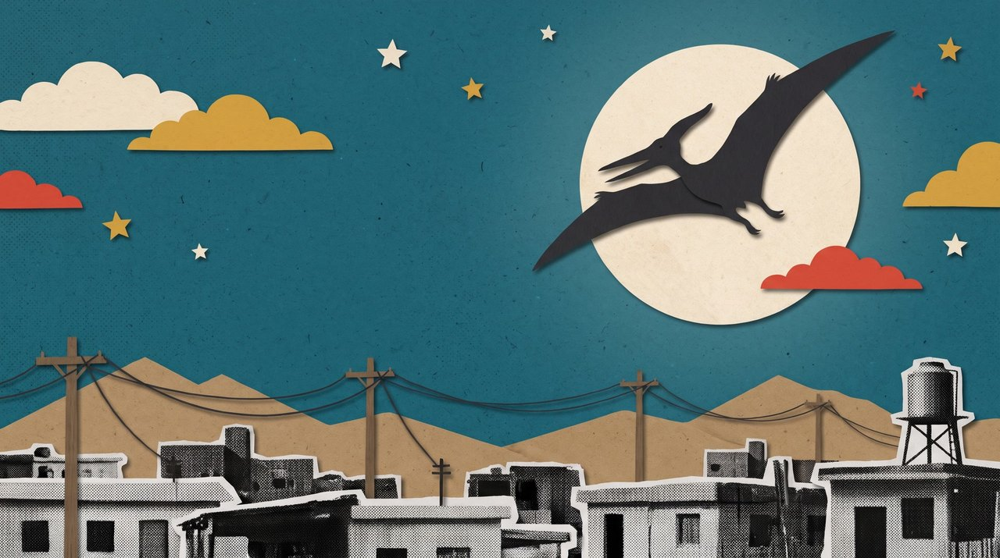

2. **Phone**
   Top-down overhead view of a smartphone lying face-up on a kraft-paper desk, the phone cut from a black-and-white halftone photograph with torn white paper edges. Its screen glows and is filled edge to edge with a small night-sky picture: a dark winged pterodactyl silhouette in front of a cream moon on a teal sky. Around the phone on the desk: a halftone cutout of a coffee mug, a few torn paper scraps in mustard yellow and tomato red, a strip of masking tape. The phone sits in the centre, slightly tilted. [style lock] No app interface.

   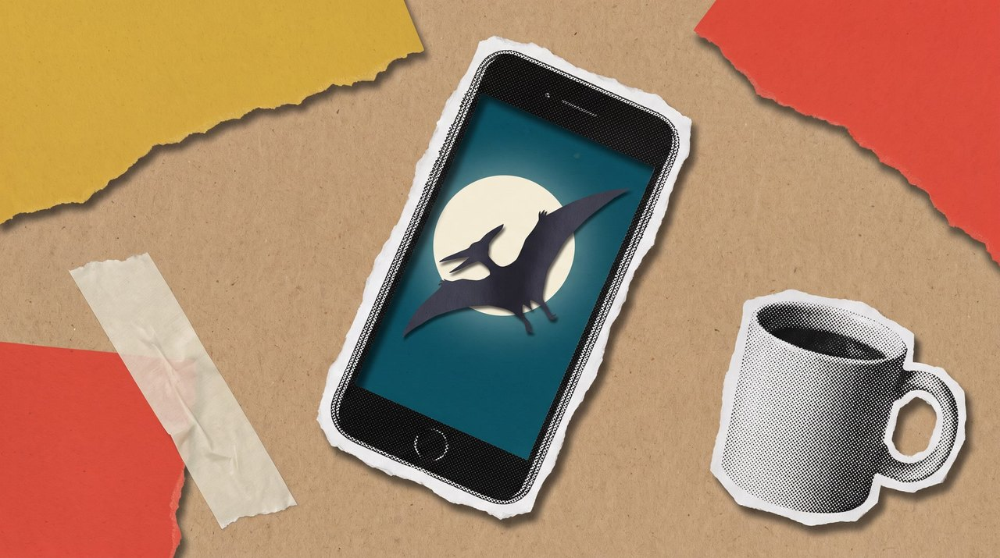

3. **Border city**
   Wide panoramic view of a sprawling desert border city at dusk, made as an editorial paper-collage explainer illustration. In the foreground, low flat-roofed houses, street lamps and power lines cut from black-and-white halftone photographs with torn white paper edges. Behind the city rises a large rugged mountain range cut from kraft-brown and ochre paper. A tomato-red paper sun sits low on the horizon and the sky is layered cream, mustard-yellow and soft teal torn paper bands. Straight-on, flat layered composition. [style lock]

   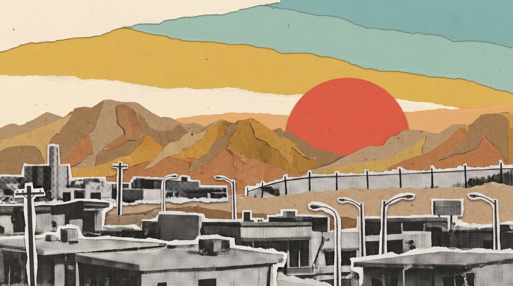

4. **TV, take 1: FAILED (it drew a bat)**
   A boxy retro television set from the 1980s, cut from a black-and-white halftone photograph with torn white paper edges, stands on a kraft-paper table in the centre of the frame. Its screen shows a grainy black-and-white night sky with **a dark winged silhouette** in the middle. Above the television, three paper cutouts of classic flying saucers in mustard yellow, teal and tomato red hang from thin strings. Behind it, a cream textured paper wall with a soft teal spotlight circle. Medium shot, straight-on. [style lock]

   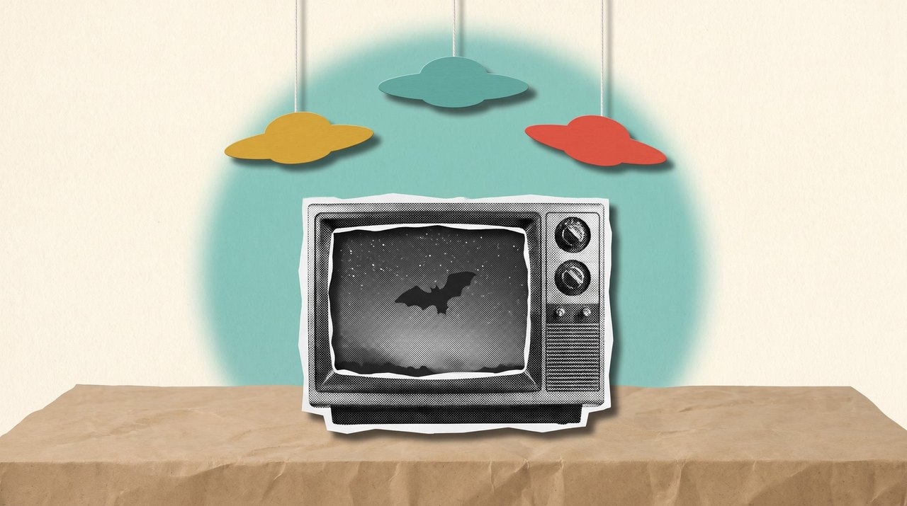

   **TV, take 2: fixed with a lock sentence.** Name the animal and its parts:
   > Its screen shows a grainy black-and-white night sky with the dark silhouette of a pterodactyl in the middle: a flying reptile with a long pointed beak, a backward-pointing crest on the back of its head and long narrow leathery wings, seen from the side.

   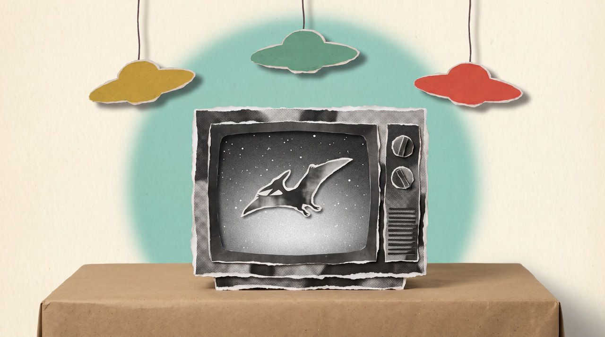

5. **Blank sign + magnifier** (the sign is left blank on purpose; Claude writes the words in code)
   Front view of a two-storey corner shop building in a Mexican town, cut from a black-and-white halftone photograph with torn white paper edges, on a cream textured paper background. Across the front of the building hangs a large plain sign board made of blank cream paper, completely empty. In front of the blank sign, on the left side of it, floats a big paper-cutout magnifying glass with a tomato-red handle and a cream rim, its lens slightly enlarging the empty paper behind it. Straight-on, the building fills the lower two thirds of the frame. [style lock]

   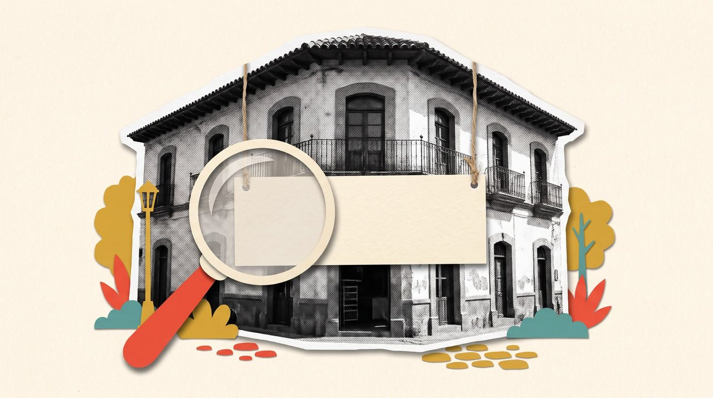

6. **Fossil strata**
   A cross-section of the ground made of stacked torn paper layers like rock strata, in sand, ochre, kraft brown and dark umber, each layer with a ragged torn edge and a soft shadow. In the deepest dark layer lies a pale cream paper-cutout fossil skeleton of a pterosaur: long folded wing bones, small body, long beak and a backward-pointing crest on the skull. At the very top, a thin strip of desert surface with a small halftone cutout of a cactus and a few tiny houses under a teal paper sky. Straight-on side view, the layers fill most of the frame. [style lock]

   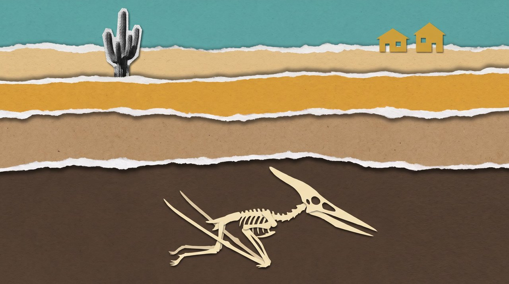

7. **Frigatebird**
   A magnificent frigatebird, a large black seabird with long narrow angled wings, a deeply forked tail, a long hooked beak and a bright inflated throat pouch, cut from a black-and-white halftone photograph with torn white paper edges, the throat pouch made of tomato-red paper. It glides from right to left across a dusk sky of cream, mustard-yellow and soft teal torn paper bands, high above a row of low flat-roofed desert houses and power lines cut from halftone photographs along the bottom of the frame. Wide shot, straight-on. [style lock]

   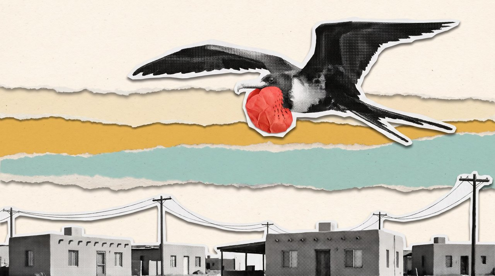

8. **Corkboard**
   A cork pinboard that fills the whole frame, covered with small paper cutouts held by tomato-red pushpins: little smartphone shapes cut from halftone photographs, each showing a tiny dark pterodactyl silhouette on a teal screen, cartoon paper dinosaurs in mustard yellow and teal, a halftone cutout of a full moon, torn scraps of cream paper. Red string runs between the pins, connecting the cutouts like a detective board. Straight-on, evenly lit, soft shadows under every cutout. [style lock]

   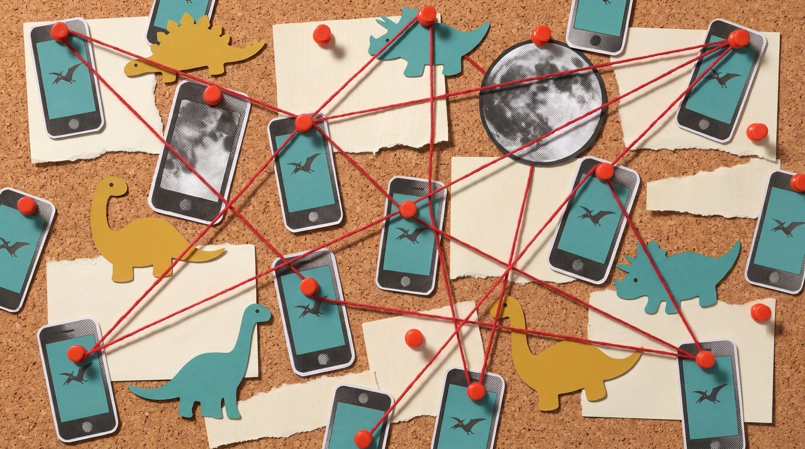

---

## 3. The 8-second beat formula (Veo 3.1 Fast, 20 credits)

```
0-2 s: <the opening frame settles>
2-6 s: <ONE main action>
6-8 s: <a clean ending>
<lock sentences: what must stay the same>
<ONE camera move>
<location>
[style lock v2]
Sound: <3-5 sounds you want to hear>. No music.
```
Each clip uses its keyframe as the first frame. Flow MCP also adds a "no text on screen" clause to every video prompt.

---

## 4. Clip prompts + lock sentences (all real takes)

**Sky, take 1: FAILED** (second head at 3 s, turned white and flew back the wrong way at 4.6 s, clouds multiplied 3 → 9+, moved on twos)
```
0-2 s: the black cardstock pterodactyl glides in front of the big cream paper moon and gives one slow, deep flap of its long paper wings. 2-6 s: it keeps gliding up and to the left across the teal paper sky, high above the halftone rooftops and power lines, its wings tilting gently as it banks. 6-8 s: it soars on toward the upper left corner while the paper clouds drift slowly to the right and the paper stars twinkle. Static locked-off wide shot, the camera never moves. Night sky over a desert city in northern Mexico. [style lock with "stop-motion paper feel"] Sound: night wind over the rooftops, power lines humming, a distant dog barking twice, one heavy leathery wingbeat whoosh on the flap, soft paper rustle. No music.
```
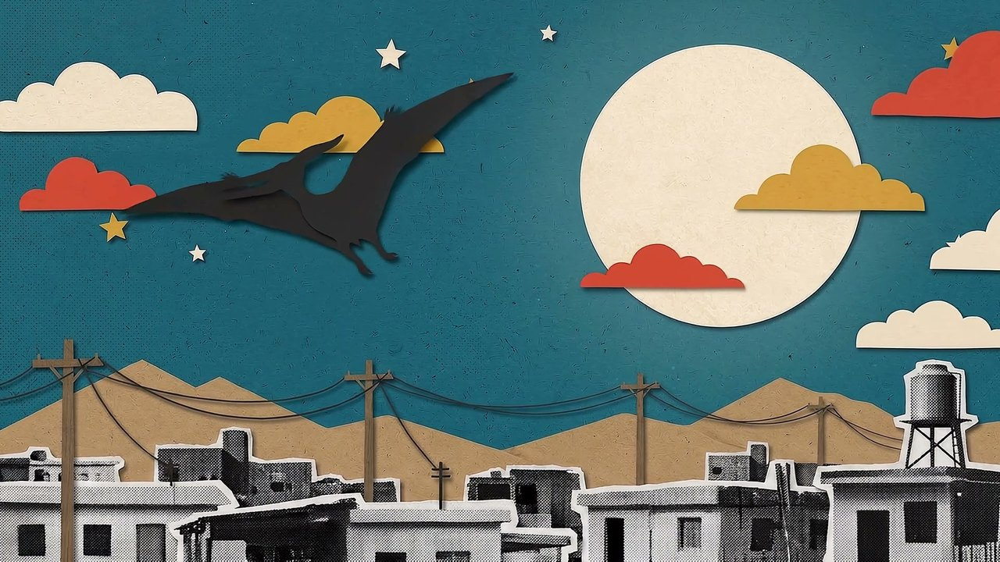

**Sky, take 2: USED** (the lock sentences fixed 3 of the 4 problems)
```
0-2 s: the black cardstock pterodactyl glides in front of the big cream paper moon and gives one slow, deep flap of its long paper wings. 2-6 s: it glides on to the left across the teal paper sky, high above the halftone rooftops and power lines, its wings tilting gently as it banks. 6-8 s: it keeps gliding toward the left side of the frame, wings spread wide. The pterodactyl is one single solid-black cardstock cutout with one head, and it stays solid black in every frame. It travels in one direction only, from right to left. The sky keeps exactly the moon, clouds and stars of the first frame; they only drift slowly. Static locked-off wide shot, the camera never moves. Night sky over a desert city in northern Mexico. [style lock v2] Sound: night wind over the rooftops, power lines humming, a distant dog barking twice, one heavy leathery wingbeat whoosh on the flap, soft paper rustle. No music.
```

**Phone, take 1: FAILED** (the phone stood up on its edge and the pterodactyl climbed out of the screen on legs and walked)
```
0-2 s: the halftone paper smartphone lies still on the kraft-paper desk, its screen glowing with the black paper pterodactyl in front of the cream moon. 2-6 s: the phone starts to buzz: it vibrates hard in short bursts and shuffles a few millimetres across the desk with each burst, while the torn paper scraps beside it tremble. 6-8 s: the phone keeps buzzing in quick bursts and the screen glows a little brighter. The phone stays face-up with the same picture on its screen in every frame; the mug and the masking tape stay where they are. Slow push-in from directly overhead toward the phone. [style lock v2] Sound: a phone vibrating hard against a paper desk in short repeated buzzes, a rapid flurry of soft notification pings, paper scraps rustling. No music.
```
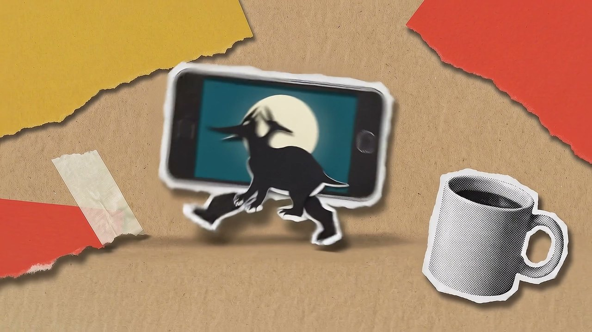

**Phone, take 2: USED**
```
0-2 s: the halftone paper smartphone lies flat and face-up on the kraft-paper desk, its screen glowing with the black paper pterodactyl in front of the cream moon. 2-6 s: the phone receives a flood of notifications: its screen light pulses brighter with every buzz and it trembles in place with tiny fast vibrations, while the torn paper scraps around it quiver. 6-8 s: the pulses come faster and the screen glows brightest. The phone lies flat and face-up, in the same spot on the desk, in every frame; the picture on its screen stays the same flat image; the mug and the masking tape stay where they are. Slow push-in from directly overhead toward the phone. [style lock v2] Sound: a phone buzzing against a paper desk in short repeated bursts, a rapid flurry of soft notification pings, paper scraps rustling. No music.
```

**City, take 1: FAILED** (at 5.4 s the flat city rebuilt itself into a different 3D street)
```
0-2 s: the tomato-red paper sun sits low on the kraft-paper mountains above the desert border city. 2-6 s: the sun slowly sinks behind the mountain range and the torn-paper sky bands darken from mustard yellow to deep teal. 6-8 s: the halftone street lamps switch on one after another, each throwing a small warm yellow glow. The houses, poles and mountains keep their shapes in every frame. Very slow push-in toward the city. [style lock v2] Sound: distant traffic, dogs barking far away, dry desert wind, evening crickets, a soft electric click as each street lamp switches on. No music.
```
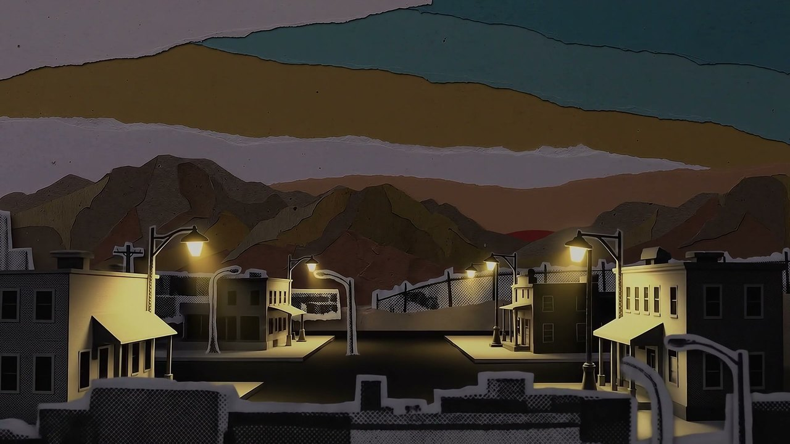

**City, take 2: USED** (stronger lock sentence + a static camera instead of the push-in)
```
0-2 s: the tomato-red paper sun sits low on the kraft-paper mountains above the desert border city. 2-6 s: the sun slowly sinks behind the mountain range and the torn-paper sky bands darken from mustard yellow to deep teal. 6-8 s: the small halftone street lamps that are already in the picture switch on one after another, each throwing a small warm yellow glow. The city stays exactly the same flat halftone paper cutout of the first frame in every frame: the same rooftops, poles, fence and lamps, nothing new appears and nothing is rebuilt; only the light changes. Static locked-off wide shot, the camera never moves. [style lock v2] Sound: distant traffic, dogs barking far away, dry desert wind, evening crickets, a soft electric click as each street lamp switches on. No music.
```

**TV: USED**
```
0-2 s: the three paper flying saucers in mustard yellow, teal and tomato red sway gently on their strings above the retro halftone television. 2-6 s: the black-and-white picture on the TV screen flickers with static while the pterodactyl on the screen flaps its long wings and glides across the grainy starry sky. 6-8 s: the TV picture rolls once with a burst of static and settles again, the saucers still swaying. The pterodactyl on the screen keeps its long pointed beak and backward crest in every frame; the television and the table stay where they are. Slow push-in toward the TV screen. [style lock v2] Sound: the low hum of an old CRT television, crackling static that swells when the picture rolls, a muffled, indistinct announcer voice from the TV speaker, the saucers' strings creaking softly. No music.
```

**Sign: USED**
```
0-2 s: the big paper magnifying glass with the tomato-red handle hovers over the left end of the plain cream paper sign hanging on the halftone building. 2-6 s: it glides slowly to the right along the sign, its lens gently enlarging the plain cream paper as it passes. 6-8 s: it stops at the right end of the sign and tilts slightly, and the sign swings a little on its ropes. The sign stays plain cream paper in every frame. Static locked-off shot, the camera never moves. A small town street in Mexico. [style lock v2] Sound: a quiet town street, a car passing in the distance, small birds chirping, a soft paper slide as the magnifying glass moves, the sign's ropes creaking. No music.
```

**Fossil: USED**
```
0-2 s: the torn-paper rock layers lie still under the teal paper sky, the little halftone cactus sways slightly in the wind. 2-6 s: slow push-in down toward the deepest dark-brown layer, the paper layers shifting very slightly against each other like stacked sheets of paper. 6-8 s: the camera settles close on the cream paper fossil skull with its long beak and backward crest, which lies perfectly still. The fossil keeps its shape and colour in every frame. One slow push-in, nothing else moves the camera. [style lock v2] Sound: a deep low rumble of the earth, faint dry wind above ground, a soft gritty crackle of settling rock. No music.
```

**Frigatebird: USED**
```
0-2 s: the halftone frigatebird with its red paper throat pouch glides to the left across the dusk paper sky. 2-6 s: it gives two slow, powerful flaps of its long angled wings and keeps gliding left. 6-8 s: it banks slightly and soars on to the left, wings spread. It is one single bird, black and white with a red throat pouch, the same in every frame, and it travels in one direction only, from right to left. The torn-paper sky bands, houses and power lines keep their shapes. Slow pan to the left, following the bird. [style lock v2] Sound: warm coastal wind, two deep whooshing wingbeats, one distant seabird call, faint town sounds below. No music.
```

**Corkboard: USED**
```
0-2 s: the cork pinboard full of paper phones, paper dinosaurs and the halftone moon, all held by tomato-red pushpins and joined by red string. 2-6 s: slow push-in toward the centre of the board; the red strings tremble gently and the loose corners of the paper cutouts lift and flutter in a light breeze. 6-8 s: the camera settles on the phone in the centre with the small pterodactyl on its screen. Every cutout and pin stays in its place in every frame. One slow push-in. [style lock v2] Sound: paper rustling in a light breeze, strings humming softly, a faint busy office murmur, a single pushpin click. No music.
```

---

## 5. Voices (ElevenLabs, eleven_multilingual_v2)

| Role | Voice | Speed | Stability | Style |
|---|---|---|---|---|
| Tutorial | Liam (Energetic, Social Media Creator) | 1.12 | 0.40 | 0.25 |
| Explainer | Alice (Clear, Engaging Educator) | 1.00 | 0.50 | 0.15 |

Tip: write "Vay-oh" in the script so the voice says "Veo" correctly.

## 6. The real bill

| Item | Cost |
|---|---|
| Flow credits at start | 1,028 |
| 9 keyframe images (Nano Banana Pro), including the bat redo | 0 |
| 11 Veo 3.1 Fast takes × 20 (8 used, 3 broke) | 220 |
| Flow credits left | 808 |
| ElevenLabs narration, both voices | 4,807 characters |
| ElevenLabs music | 3 tracks, 6.5 min |
