# UGC Sneaker Ad: Prompt Pack

The demo ad: **"one day in new PACELYs"**, a 24-second vertical UGC ad (9:16). PACELY is a made-up brand, and the shoe and the creator, Maya, are both AI-generated. Neither one exists.

Every prompt from the video "How I Make UGC Ads With Claude + Veo 3.1" is here, copied exactly as it was sent to Google Flow and ElevenLabs on 2026-11-20. The only change is that local file paths are replaced with what each file was. Nothing was cleaned up afterwards, and the takes that went wrong are shown next to how they were fixed.

Tools:
- **Claude Code** writes the prompts, checks every frame, cuts the edit and codes the captions and end card.
- **Google Flow**: Nano Banana Pro images at 0 credits, Veo 3.1 Fast at 20 credits per 8-second clip.
- **[Flow MCP](https://github.com/GTAI-1/flow-mcp)** lets Claude drive Flow ([setup guide](../SETUP-FLOW-MCP.md)).
- **ElevenLabs** makes the voice-over and the sound effects ([setup guide](../SETUP-ELEVENLABS-MCP.md)).

---

## 1. One story, not a stack of clips

A 5-second clip can't sell anything. The whole ad is one day in one outfit, and it opens with a question that the last shot answers.

| Time | Beat | Voice-over line |
|---|---|---|
| 0.0-2.8 s | Delivery: box at the door | "Okay, my new running shoes just came!" |
| 2.8-6.3 s | Unboxing on the sofa | "New rule: I wear them all day, and see if they're actually comfy." **(the question)** |
| 6.3-9.4 s | Try-on, then a light bounce (punch-in) | "First steps... oh, they're so light." |
| 9.4-11.9 s | Morning commute (feet) | "Morning commute." |
| 11.9-14.1 s | Coffee run | "Coffee run." |
| 14.1-17.65 s | Evening run | "Even my evening run." |
| 17.65-21.5 s | Evening, on the same sofa where she opened the box | "End of the day... still comfy. I'm obsessed." **(the answer)** |
| 21.5-24 s | End card (code) | "Trust me, you'll want a pair. Link's in my bio!" |

The template is question → day → answer → CTA.

---

## 2. The product lock

Claude writes the shoe like a factory spec: one colour and one material per part. This exact sentence goes into every prompt that shows the shoe:

```
deep olive-green ripstop mesh upper, darker olive suede at the toe and heel, bright lime-green laces, a lime-green heel pull tab, an off-white midsole with one lime-green stripe, a dark charcoal lugged outsole
```

**Product sheet (Nano Banana Pro, 16:9, 0 credits).** This one image is the reference for every keyframe that shows the shoes.
```
Product turnaround sheet of one single trail running sneaker, shown five times in a neat row on a seamless light grey studio background, the same left shoe at the same scale in every view: side view, three-quarter front view, top view looking down, sole view from below, back view. The shoe is a low-top trail running sneaker: deep olive-green ripstop mesh upper, darker olive suede overlays around the toe cap and the heel, bright lime-green flat laces, a lime-green pull tab on the heel, a padded olive tongue, a thick off-white midsole with one lime-green stripe along its side, and a dark charcoal rubber outsole with chunky square lugs. Clean e-commerce product photography, soft even studio light, a soft contact shadow under each view, every view clearly separated with space around it. No text, no letters, no numbers, no logos anywhere on the shoe or the background.
```

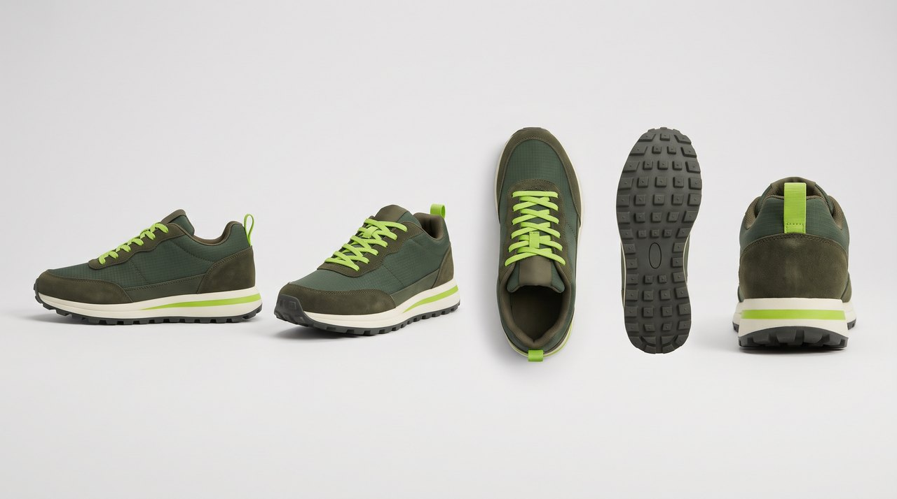

**No logo on the shoe.** AI can't keep letters straight, so the brand name, the captions, the CTA button and the AI label are all added in code afterwards.

---

## 3. Lock the person and the outfit

**The creator: a Flow character, drawn from a description** (`flow_character`, 9:16). These are the final look settings, after two edits: a new face, then full polished makeup.
```
A beautiful young woman in her mid-20s, an original everyday person, not a celebrity. Fair light skin, long soft-wavy chestnut-brown hair falling past her shoulders to mid-back with a loose side part, warm hazel eyes, a bright friendly smile with natural teeth. Full, polished makeup: flawless foundation, soft contour and highlight, rosy blush, sculpted brows, warm-brown eyeshadow, winged eyeliner, full mascara lashes, glossy rose-nude lipstick. She wears an oversized cream knit sweater and light-wash straight-leg jeans. Natural soft window light, plain warm-white wall behind her, framed from the chest up, looking straight at the camera, casual phone-camera photo look.
```
Personality: `Upbeat, relaxed and honest; talks to the camera like a friend, reacts with real surprise and small laughs.`

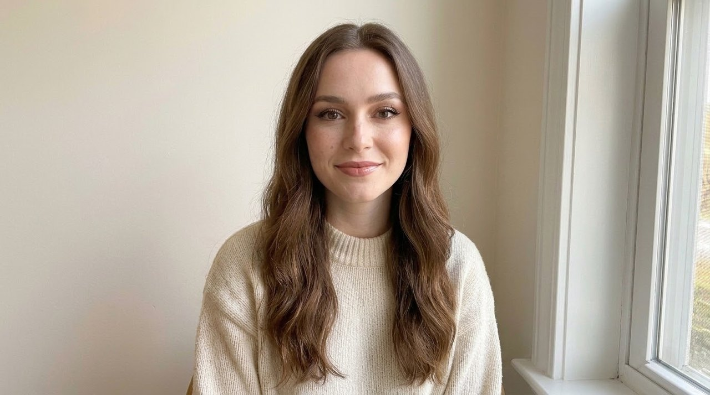

**The outfit.** Keyframe 1 sets her clothes for the whole day: *a soft heather-grey crewneck sweatshirt, black high-waisted leggings and white crew socks*. Every later prompt repeats that outfit.

**The reference chain.** Each keyframe gets up to 3 reference images:

| Keyframe | References |
|---|---|
| 1 Delivery | portrait |
| 2 Unboxing, 3 Try-on, 5 Coffee, 6 Run | portrait + product sheet + keyframe 1 |
| 4 Commute (feet only, no face) | product sheet + keyframe 1 |
| 7 Evening sofa | keyframe 2 (same living room) + product sheet + portrait |

---

## 4. Keyframes first (Nano Banana Pro, 9:16, 0 credits)

Keyframes are free. 7 prompts × 2 variants = 14 images, and 7 were picked. Credits only go on frames already chosen.

1. **Delivery** (picked v2)
   ```
   Vertical 9:16 photo that looks like a frame from a casual phone video, UGC style, photorealistic. A young woman with fair skin, long soft-wavy chestnut-brown hair and full polished makeup (the woman in the reference image, same face and hair), wearing a soft heather-grey crewneck sweatshirt, black high-waisted leggings and white crew socks, no shoes. She stands just inside the wide-open white front door of a bright apartment entryway with a light oak floor, holding one closed plain kraft-brown cardboard shoebox with both hands at chest height, looking down at it with a delighted, surprised open-mouthed smile. Soft morning daylight comes in through the doorway behind her. Camera at chest height about two metres inside the hallway, facing her, her whole body from head to socks in frame. Plain walls, no posters, no signs, no text or letters anywhere, no logos on the box.
   ```
   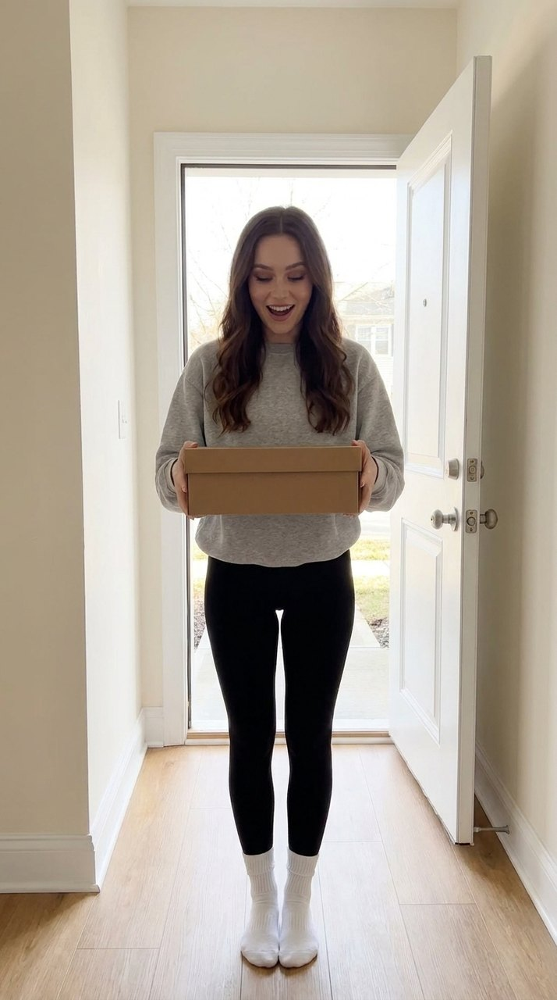

2. **Unboxing** (picked v1)
   ```
   Photorealistic frame from a casual vertical phone video, UGC style. The same young woman as in the reference images (fair skin, long soft-wavy chestnut-brown hair, full polished makeup) in the same soft heather-grey crewneck sweatshirt, black high-waisted leggings and white crew socks, no shoes. She sits on a light-grey fabric sofa in a bright, airy apartment living room with white walls, a light oak floor, a round oak coffee table and a large window with sheer white curtains, soft morning daylight. On her lap is an open plain kraft-brown shoebox with white tissue paper. She holds one trail running sneaker up beside her face with both hands, its side facing the camera, with an amazed open-mouthed smile. The sneaker is exactly the product in the reference: deep olive-green ripstop mesh upper, darker olive suede at the toe and heel, bright lime-green laces, a lime-green heel pull tab, an off-white midsole with one lime-green stripe, a dark charcoal lugged outsole. Camera at her eye level about 1.2 metres away, framing her from the knees up. Plain surfaces, no text, letters or logos anywhere.
   ```
   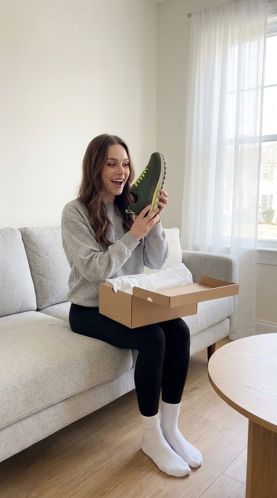

3. **Try-on** (picked v2)
   ```
   Photorealistic frame from a casual vertical phone video, UGC style. The same young woman as in the reference images (fair skin, long soft-wavy chestnut-brown hair, full polished makeup) in the same soft heather-grey crewneck sweatshirt and black high-waisted leggings. She sits on a small light-oak bench against the wall of the same bright apartment entryway with the light oak floor and the closed white front door beside her, morning daylight. On her feet are the trail running sneakers from the product reference, laced with neat tied bows: deep olive-green ripstop mesh upper, darker olive suede at the toe and heel, bright lime-green laces, a lime-green heel pull tab, an off-white midsole with one lime-green stripe, a dark charcoal lugged outsole. Her hands rest on her knees and she smiles down at her new sneakers. Camera low at knee height about 1.5 metres in front of her, framing her whole body, the sneakers large and sharp in the foreground. Plain surfaces, no text, letters or logos anywhere.
   ```
   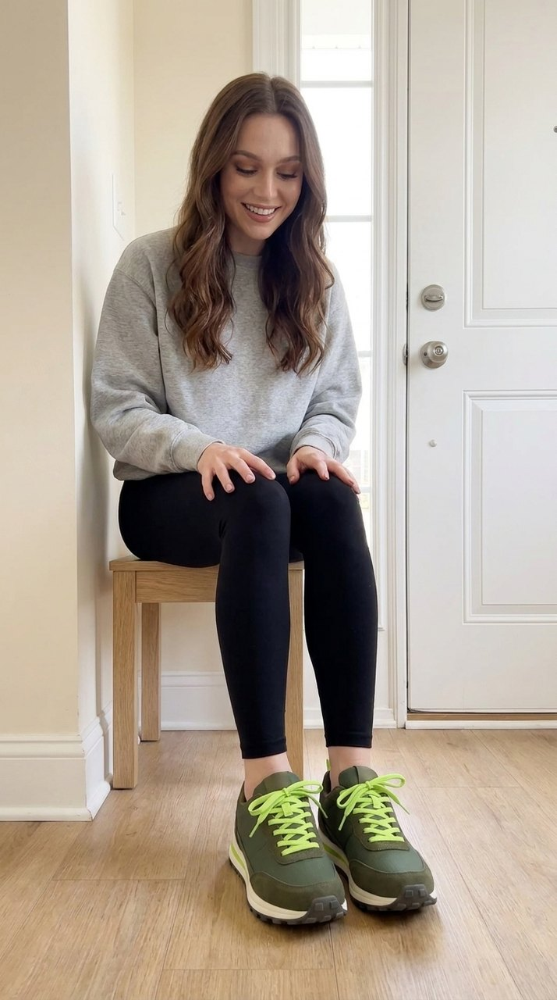

4. **Commute** (picked v1)
   ```
   Photorealistic frame from a casual vertical phone video, UGC style. Low shot at ankle height on a sunny, quiet tree-lined city street in the morning: a woman's feet mid-stride in the trail running sneakers from the product reference (deep olive-green ripstop mesh upper, darker olive suede at the toe and heel, bright lime-green laces, a lime-green heel pull tab, an off-white midsole with one lime-green stripe, a dark charcoal lugged outsole), her legs in black high-waisted leggings and white crew socks, stepping onto the white stripes of a zebra crossing. Long soft morning shadows on the asphalt, the street behind softly blurred with trees and low buildings. The sneakers are sharp and fill the lower half of the frame. Plain surfaces, no text, letters or logos anywhere.
   ```
   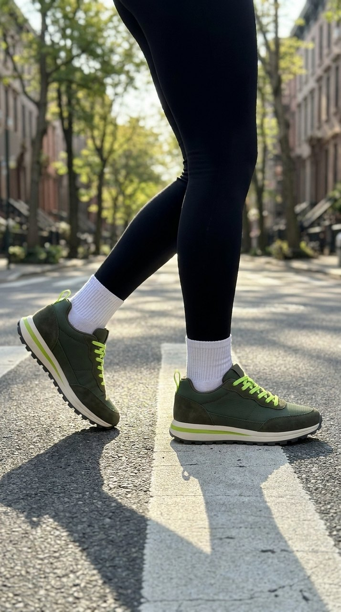

5. **Coffee run** (picked v1)
   ```
   Photorealistic frame from a casual vertical phone video, UGC style. The same young woman as in the reference images (fair skin, long soft-wavy chestnut-brown hair, full polished makeup) in the same soft heather-grey crewneck sweatshirt and black high-waisted leggings, walking toward the camera on a sunny sidewalk at midday, just outside a small unmarked café with a big glass window, potted plants and a wooden bench. She holds a plain white takeaway coffee cup with a white lid in one hand and smiles at the camera mid-step. On her feet are the trail running sneakers from the product reference: deep olive-green ripstop mesh upper, darker olive suede at the toe and heel, bright lime-green laces, a lime-green heel pull tab, an off-white midsole with one lime-green stripe, a dark charcoal lugged outsole. Camera at chest height about 3 metres ahead of her, framing her whole body. Plain surfaces, no text, letters or logos anywhere.
   ```
   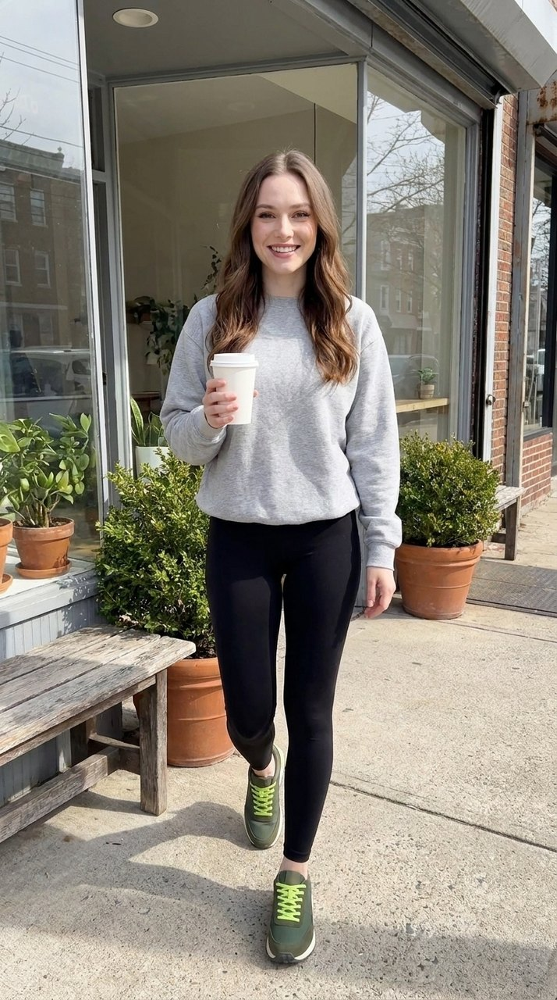

6. **Evening run** (picked v1)
   ```
   Photorealistic frame from a casual vertical phone video, UGC style. Golden hour in a green city park: the same young woman as in the reference images (fair skin, long soft-wavy chestnut-brown hair, full polished makeup) in the same soft heather-grey crewneck sweatshirt and black high-waisted leggings, jogging toward the camera mid-stride along a paved path lined with trees, hair moving, relaxed and happy. Warm low sun behind her gives a golden rim light. On her feet are the trail running sneakers from the product reference: deep olive-green ripstop mesh upper, darker olive suede at the toe and heel, bright lime-green laces, a lime-green heel pull tab, an off-white midsole with one lime-green stripe, a dark charcoal lugged outsole. Camera at hip height a few metres ahead of her, framing her whole body. Plain surfaces, no text, letters or logos anywhere.
   ```
   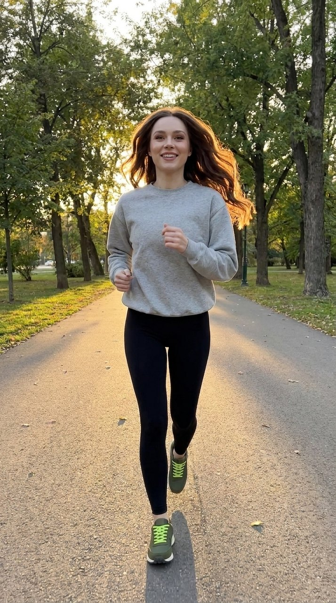

7. **Evening sofa: FAILED twice, then fixed**

   Tries 1 and 2 used the same prompt, and Flow returned an error tile both times, with no image. The likely cause was the low camera at the far end of the table, aimed along her legs at her feet. This is the part that changed:
   > ...leans back relaxed on the sofa, legs stretched out, her feet crossed at the ankles and resting on the edge of the round oak coffee table in the foreground... **Camera low at the far end of the coffee table, about 1.5 metres from her, the sneakers large and sharp in the lower foreground and her face clearly visible behind them.**

   **Try 3 worked: the camera moved up to her eye level** (picked v1):
   ```
   Photorealistic frame from a casual vertical phone video, UGC style. Evening in the same living room as the first reference image: the same light-grey fabric sofa, white walls and sheer white curtains, the window now deep blue dusk, a warm floor lamp glowing beside the sofa, cosy warm light. The same young woman (fair skin, long soft-wavy chestnut-brown hair, full polished makeup) in the same soft heather-grey crewneck sweatshirt and black high-waisted leggings sits back comfortably on the sofa with a happy, satisfied smile at the camera, one leg crossed over the other, still wearing the trail running sneakers from the product reference: deep olive-green ripstop mesh upper, darker olive suede at the toe and heel, bright lime-green laces, a lime-green heel pull tab, an off-white midsole with one lime-green stripe, a dark charcoal lugged outsole. Camera at her eye level about two metres away, framing her whole body on the sofa with both sneakers clearly visible. Plain surfaces, no text, letters or logos anywhere.
   ```
   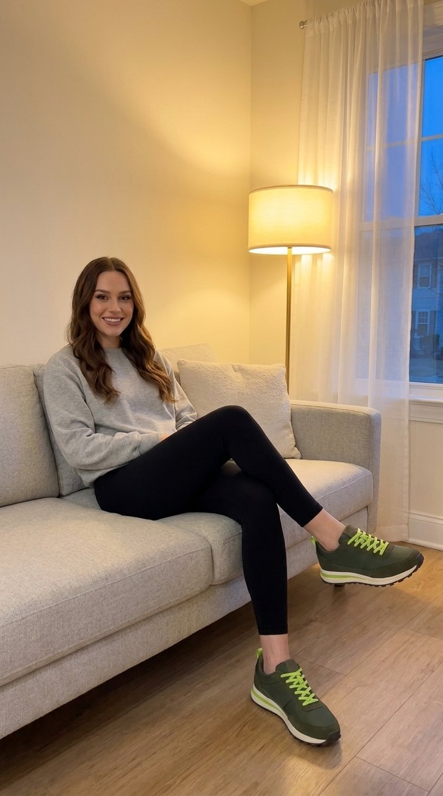

---

## 5. Veo clip prompts (Veo 3.1 Fast, 9:16, 20 credits each)

Each clip starts on its picked keyframe as the **first frame**. Every prompt follows the same order:
1. who she is and the outfit;
2. the shoe sentence;
3. a timeline in seconds;
4. the silent-creator rule;
5. the lock sentences;
6. one camera;
7. a sound line.

**The silent-creator rule.** Maya never speaks on camera, so there is nothing to lip-sync. Her voice is one ElevenLabs take, laid over the cuts. Every prompt says:
> She smiles silently the whole time and never talks.

and ends with:
> No voices, no music.

(The Flow MCP also wraps every video prompt in its own "no subtitles, no on-screen text" lines. They are not repeated below.)

**Clip 1: Delivery** (used 1.6-4.4 s)
```
A young woman with fair skin, long soft-wavy chestnut-brown hair and full polished makeup, in a soft heather-grey crewneck sweatshirt, black high-waisted leggings and white crew socks, stands just inside the wide-open white front door of a bright apartment entryway with a light oak floor, holding one closed plain kraft-brown shoebox with both hands at chest height. 0-1.5 s: she looks down at the box with a delighted, surprised smile. 1.5-3.5 s: she looks up at the camera with wide excited eyes and gives the box one small happy lift. 3.5-8 s: she walks toward the camera at an easy pace, holding the box in both hands and smiling. She smiles silently the whole time and never talks. The box stays closed and keeps the same plain shape in every frame. The front door stays completely still. She keeps the same face, hair, makeup and clothes in every frame. Fixed camera at chest height about two metres down the hallway, the camera never moves. Casual vertical phone video, UGC look, soft morning daylight, realistic, smooth natural motion. Sound: quiet apartment ambience, birds outside the open door, soft footsteps on the wooden floor. No voices, no music.
```

**Clip 2: Unboxing** (used 0.2-3.7 s; it came back silent, so the room sound comes from clip 3)
```
A young woman with fair skin, long soft-wavy chestnut-brown hair and full polished makeup, in a soft heather-grey crewneck sweatshirt, black high-waisted leggings and white crew socks, sits on a light-grey sofa in a bright living room with an open plain kraft-brown shoebox and white tissue paper on her lap. She holds one trail running sneaker up beside her face with both hands: deep olive-green ripstop mesh upper, darker olive suede at the toe and heel, bright lime-green laces, a lime-green heel pull tab, an off-white midsole with one lime-green stripe, a dark charcoal lugged outsole. 0-2 s: she looks at the sneaker with an amazed smile. 2-5 s: she turns her face to the camera and brings the sneaker a little closer to the camera, keeping the same side of the shoe facing the lens and the toe pointing the same way. 5-8 s: she holds the sneaker still beside her face and nods happily at the camera. She smiles silently the whole time and never talks. The sneaker keeps the same shape, colours and orientation in every frame. She keeps the same face, hair, makeup and clothes in every frame. Fixed camera at her eye level about 1.2 metres away, the camera never moves. Casual vertical phone video, UGC look, soft morning daylight, realistic, smooth natural motion. Sound: a soft rustle of tissue paper, quiet room ambience, birds outside the window. No voices, no music.
```

**Clip 3: Try-on** (fixed in the edit, see section 6)
```
A young woman with fair skin, long soft-wavy chestnut-brown hair and full polished makeup, in a soft heather-grey crewneck sweatshirt and black high-waisted leggings, sits on a small light-oak bench beside the closed white front door of a bright entryway, hands on her knees. On her feet are trail running sneakers laced with neat bows: deep olive-green ripstop mesh upper, darker olive suede at the toe and heel, bright lime-green laces, a lime-green heel pull tab, an off-white midsole with one lime-green stripe, a dark charcoal lugged outsole. 0-1.5 s: she looks down at her sneakers and smiles. 1.5-3.5 s: she pushes on her knees and stands up in one smooth motion. 3.5-6 s: standing, she does two small, light bounces on her toes and grins at the camera. 6-8 s: she stands still and smiles at the camera. She smiles silently the whole time and never talks. Both sneakers stay on her feet with the same laces and colours in every frame. She keeps the same face, hair, makeup and clothes in every frame. Fixed low camera at knee height about two metres in front of her, framed wide enough that her whole body stays in frame after she stands; the camera never moves. Casual vertical phone video, UGC look, soft morning daylight, realistic, smooth natural motion. Sound: quiet entryway ambience, the bench creaking softly as she stands, light footsteps on the wooden floor. No voices, no music.
```

**Clip 4: Commute** (used 1.0-3.5 s)
```
Low tracking shot at ankle height on a sunny, quiet tree-lined city street in the morning. A woman's feet in trail running sneakers (deep olive-green ripstop mesh upper, darker olive suede at the toe and heel, bright lime-green laces, a lime-green heel pull tab, an off-white midsole with one lime-green stripe, a dark charcoal lugged outsole), her legs in black high-waisted leggings and white crew socks, walk straight ahead across the white stripes of a zebra crossing with steady, easy steps. The camera glides along with her at the same speed, staying at ankle height, so her feet stay in the same part of the frame while the stripes and the street slide past. Both sneakers keep the same shape, laces and colours in every frame. Long soft morning shadows. Casual vertical phone video, UGC look, realistic, smooth natural motion. Sound: crisp footsteps on asphalt, gentle morning city ambience, distant traffic, birds in the trees. No voices, no music.
```

**Clip 5: Coffee run** (used 1.2-3.4 s; it came back silent, so the street sound is an ElevenLabs effect, see section 7)
```
A young woman with fair skin, long soft-wavy chestnut-brown hair and full polished makeup, in a soft heather-grey crewneck sweatshirt and black high-waisted leggings, walks toward the camera along a sunny sidewalk at midday, past a small café front with a big glass window, potted plants and a wooden bench. She holds a plain white takeaway coffee cup with a white lid in her right hand. On her feet are trail running sneakers: deep olive-green ripstop mesh upper, darker olive suede at the toe and heel, bright lime-green laces, a lime-green heel pull tab, an off-white midsole with one lime-green stripe, a dark charcoal lugged outsole. 0-8 s: she walks straight toward the camera at an easy, happy pace, smiling at the camera; at 2-4 s she lifts the cup a little toward the camera like a small cheers, then lowers it. The camera moves smoothly backward at the same speed at chest height, keeping her whole body from head to sneakers in frame. She smiles silently the whole time and never talks. The cup stays upright in her right hand. Both sneakers keep the same shape, laces and colours in every frame. She keeps the same face, hair, makeup and clothes in every frame. Casual vertical phone video, UGC look, bright midday sun, realistic, smooth natural motion. Sound: her footsteps on the pavement, gentle street and café ambience, a few birds. No voices, no music.
```

**Clip 6: Evening run** (used 0.5-4.05 s)
```
Golden hour in a green city park. A young woman with fair skin, long soft-wavy chestnut-brown hair and full polished makeup, in a soft heather-grey crewneck sweatshirt and black high-waisted leggings, jogs straight toward the camera along a paved path lined with trees, at a steady, easy pace, smiling and relaxed, her hair bouncing with each stride. On her feet are trail running sneakers: deep olive-green ripstop mesh upper, darker olive suede at the toe and heel, bright lime-green laces, a lime-green heel pull tab, an off-white midsole with one lime-green stripe, a dark charcoal lugged outsole. 0-8 s: she keeps jogging straight toward the camera the whole time. The camera moves smoothly backward at the same speed at hip height, keeping her whole body from head to sneakers in frame. Warm low sun behind her gives a golden rim light. She smiles silently and never talks. Both sneakers keep the same shape, laces and colours in every frame. She keeps the same face, hair, makeup and clothes in every frame. Casual vertical phone video, UGC look, realistic, smooth natural motion. Sound: her steady running footsteps on the path, light breathing, birds in the trees, a soft breeze. No voices, no music.
```

**Clip 7: Evening sofa** (fixed in the edit, see section 6)
```
Evening in a cosy living room lit by a warm floor lamp, deep blue dusk in the window. A young woman with fair skin, long soft-wavy chestnut-brown hair and full polished makeup, in a soft heather-grey crewneck sweatshirt and black high-waisted leggings, sits back on a light-grey sofa with one leg crossed over the other, wearing trail running sneakers: deep olive-green ripstop mesh upper, darker olive suede at the toe and heel, bright lime-green laces, a lime-green heel pull tab, an off-white midsole with one lime-green stripe, a dark charcoal lugged outsole. 0-2 s: she sinks back into the sofa cushions, relaxed and content. 2-5 s: she looks down at her sneakers and gently wiggles the raised foot, smiling. 5-8 s: she looks back at the camera with a warm, satisfied smile and gives one small nod. She smiles silently the whole time and never talks. Both sneakers keep the same shape, laces and colours in every frame. She keeps the same face, hair, makeup and clothes in every frame. The camera slowly pushes in a little toward her at eye level, smooth and steady. Casual vertical phone video, UGC look, warm cosy evening light, realistic, smooth natural motion. Sound: quiet evening room ambience, a soft creak of the sofa as she settles. No voices, no music.
```

---

## 6. Fix bad takes in the edit (no re-roll, 0 extra credits)

**Try-on: her head leaves the frame when she stands.** Cut at 1.6 s, before she rises. Then punch in on the shoes, from 2.7 s of the same clip, for the bounce.

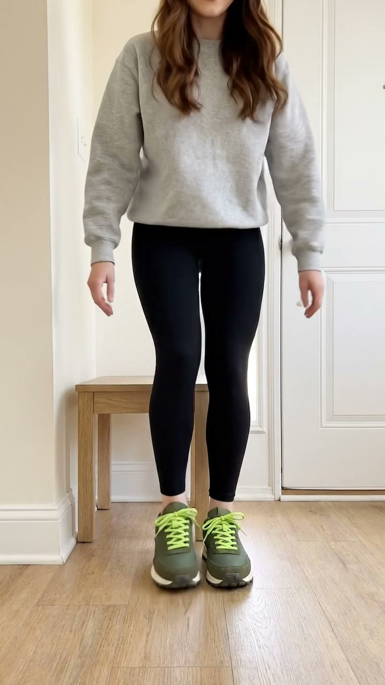

**Evening sofa: mid-clip, her raised leg swings high toward the camera.** Keep the good seconds only: 0-1.25 s, then 5.3-7.9 s.

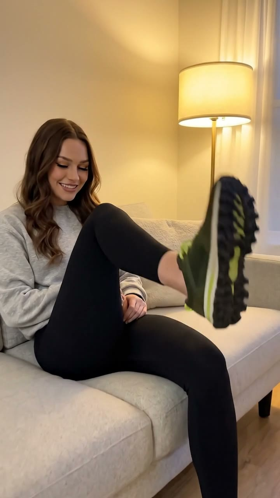

**Always check each clip's content after download.** Once, the MCP renamed an old tile from the project as the run clip. The real clip was then fetched by title.

---

## 7. Voice and sound (ElevenLabs)

**Maya's voice-over: one take, cut line by line across the shots.**
- Voice: Laura (Enthusiast, Quirky Attitude)
- Model: `eleven_multilingual_v2`
- Stability: 0.35
- Style: 0.3
```
Okay, my new running shoes just came! New rule: I wear them all day, and see if they're actually comfy. First steps... oh, they're so light. Morning commute. Coffee run. Even my evening run. End of the day... still comfy. I'm obsessed. Trust me, you'll want a pair. Link's in my bio!
```

**Sound effect 1: café street ambience** (5 s, loop on, under the coffee run). The same prompt at 6 s was rejected by the MCP before it reached the API.
```
Sunny city sidewalk outside a small cafe at midday: soft distant chatter, light footsteps on pavement, a few birds, gentle far-away traffic. No music, no clear voices.
```

**Sound effect 2: box thump** (0.7 s, on the end card)
```
A cardboard shoebox lid closing on the box, one soft dull thump, close up, no music
```

---

## 8. Words are code, never AI

These are all HTML, added on top of the video:
- the captions, with highlighted words;
- the brand name **PACELY** and the line "Take the long way.";
- the button "Shop now · link in bio →";
- the label "AI-generated ad · fictional product".

None of them is drawn by Nano Banana or Veo.

---

## 9. The real bill

| Item | Cost |
|---|---|
| Product sheet + creator portrait (Flow images) | 0 |
| 14 keyframe images (Nano Banana Pro), 7 used | 0 |
| 7 Veo 3.1 Fast clips × 20 | **140 Flow credits** |
| ElevenLabs voice-over, 283 characters | 113 ElevenLabs credits |
| ElevenLabs sound effects, 2 (0.7 s + 5 s) | 57 ElevenLabs credits |
| **ElevenLabs total** | **170 ElevenLabs credits** |

Flow credits and ElevenLabs credits are different currencies, so they are not added together. The ElevenLabs numbers come from the account's usage dashboard (4-hour blocks). On this account the rates came out to:
- **Voice-over:** 0.4 credits per character (`eleven_multilingual_v2`).
- **Sound effects:** 10 credits per second.

---

PACELY, the shoe and Maya are fictional and AI-generated; any resemblance to real brands or people is unintended. Not affiliated with or endorsed by Anthropic, Google or ElevenLabs.
